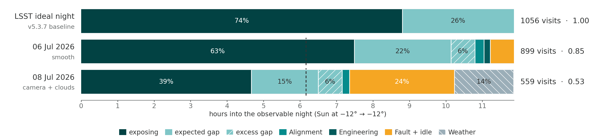

# night_budget — where one night of LSST goes

**Jira:** ROSP-10, ROSP-6, ROSP-24 · **Status:** figure B12 delivered 2026-11-02 ·
**Talk:** LSST@LATAM 2026, São Paulo, 2–6 Nov, slide 6 ("a good night and a bad night")

One night of the Simonyi survey, accounted for from the visit list up: how much of the
−12° observable night the shutter was open, how much of the rest was the slew the
simulations expect, and how much was excess. Three bars — the LSST ideal night, a real
good night, a real bad night — in the same block form as slide 3.



## 1. What the slide says

1. **Expected.** The ideal night: open shutter 74 % of the −12° night, ~1056 visits.
2. **Where we are.** 6 Jul 2026 reached 0.85 of that; 8 Jul 2026 reached 0.53.
3. **Room to improve.** On the good night the gaps between visits are already close to
   what the kinematic model allows: 9.7 s expected against 12.3 s actual, i.e. 2.6 s per
   visit of excess. The remaining shortfall is not the gaps — it is the hour at the start
   of the night and the transitions.

## 2. Definitions

| Source | Value | Use on the figure |
|---|---|---|
| OSS-REQ-0288 | visit = 34 s (2 × 15 s design; we observe 1 × 30 s) | text only |
| OSS-REQ-0289 | inter-visit interval (shutter closed → next shutter open): median < 5 s, mean < 10 s | the gap-split numbers in §5 |
| `ideal_osf.py` fit to `baseline_v5.3.7_10yrs` | ideal night: OSF = 0.7261 − 0.0169·cos(season), 30 s visits, −12° night | the "LSST ideal night" bar, and the denominator of `ratio` |
| RTN-093 | survey-start criterion: survey speed > 0.7 | dashed tick on each real bar |
| ROSP-6 | fE = fS·fA·fO, target ≥ 1; fO is this slide's quantity | **not yet measured**; the 2024 sub-factors are not a baseline |
| ROSP-22 / ROSP-24 | −12° → −12° night; category precedence | as in B1/B3/B11 |

The night is the ROSP-22 observable night, Sun altitude −12° → −12°, weather and downtime
**not** excluded. Categories are as in B10/B11: Survey Programs =
BLOCK-365/407/408/416/417/419/421, Focus and Alignment = BLOCK-T539, Engineering =
everything else on sky. Time goes to the first category that applies, weather first.

## 3. The ideal night: re-fitting the open-shutter fraction (step 0)

`rubin_nights.dayobs_utils.estimated_baseline_visit_range` is still the **v5.1** fit —
OSF = 0.74 − 0.02·cos(season), upper envelope 0.78 — so the per-night ideal had to be
re-derived from the baseline actually in use. `python/ideal_osf.py` does that: per
simulated night it takes OSF = Σ`visitExposureTime` / night length(−12°), keeps only
**full** nights (no dead interval > 10 min anywhere, including before the first and after
the last visit, so the v5.3 downtime model cannot drag the clear-night rate down), fits the
same functional form and takes the 90th percentile of the residuals as the `n_vis_high`
analogue.

| baseline | a | b | high | full nights | written 
|---|---|---|---|---|---|
| v5.3.4 (the one in Lynne's `diq_vs_visit_rate`) | 0.7305 | 0.0138 | 0.7549 | 1201 | 2026-07-14 |
| **v5.3.7 (default)** | **0.7261** | **0.0169** | **0.7518** | 1200 | 2026-10-31 |
| v5.4.0b | 0.7315 | 0.0190 | 0.7534 | 1206 | 2026-09-27 |
| v5.1 (what `rubin_nights` still uses) | 0.7400 | 0.0200 | 0.7800 | — | — |

**A v5.4 baseline does exist**, contrary to the handoff — but `baseline_v5.4.0b_10yrs.db`
is a beta written 2026-09-27, i.e. *older* than `baseline_v5.3.7_10yrs.db` (2026-10-31).
The default is therefore v5.3.7, the newest non-beta run. It makes little difference: all
three agree to within 0.008 in `ratio`.

As the handoff expected, v5.3 moved the clear-night OSF very little. 6 Jul goes from
**0.832** (v5.1) to **0.851** (v5.3.7), a move of +0.019 — just inside the 0.02 flag. Every
row keeps a `ratio_v51` column so slide 2's 0.82 can still be compared like for like.

## 4. The per-night budget (step 1)

`python/night_budget.py` writes one row per night to
`data/night_budget_<min>_<max>.csv`. It **combines** two things that already existed and
re-derives neither:

- the **per-visit gap split** from Lynne Jones' `sp_notebooks/notebooks/efficiency.ipynb`:
  `rubin_nights.rubin_scheduler_addons.add_model_slew_times` models the slew that should
  have preceded each visit, once with the TMA limits the EFD says were applied
  (`slew_model`) and once with the FBS kinematic model at 40 % TMA that the simulations
  assume (`slew_model_ideal`). Her settings are used: `wait_before_slew = 1.6 s`,
  `settle = 1.5 s`, `dome_crawl = True`, `slew_while_changing_filter = False`;
- the **ROSP-24 block hours** from `simonyi_time_loss`, read from a copy of its per-night
  CSV at `data/rosp24_per_night.csv` — no cross-folder import, so this folder stays
  extractable with `git filter-repo --subdirectory-filter night_budget`.

The Science block is split four ways over survey visits only:

| column | definition |
|---|---|
| `exposing_h` | Σ `exp_time` — shutter actually open |
| `in_visit_h` | Σ (obs_end − obs_start − exp_time) — readout etc. |
| `gap_expected_h` | Σ min(`slew_model_ideal`, gap) — the slew the sims assume |
| `gap_excess_h` | Σ (gap − expected) over survey gaps ≤ 10 min |
| `gap_expected_current_h` | the same with `slew_model` — today's TMA limits |

**Expected gap: ideal or current TMA?** The figure uses the **ideal** model
(`slew_model_ideal`), because the bar is read against the simulated ideal night; the
**current**-TMA number is reported in §5 so the two can be separated. The difference is
small today: 9.7 s against 9.2 s per visit on 6 Jul, so the TMA limits applied that night
were close to the 40 % model. Open for Bruno to overrule.

Pitfalls handled: gaps reset at each `day_obs`; ConsDB `obs_*_mjd` are TAI, converted to
UTC (−37 s); the first gap of the night and the first gap after a non-survey visit are
**not** survey gaps (the same ones Lynne nulls with `skipped_visits`); the model filter
change is 120 s and does not overlap the slew.

### Night selector

**good** = the largest `ratio` among LSST nights (`day_obs ≥ 20260629`) with weather = 0,
fault + idle < 0.5 h and engineering + alignment < 0.5 h. **bad** = 8 Jul 2026, already
explained in B11.

The fault + idle cut is on ROSP-24's published `idle_bit_hours`, not on this module's
`fault_idle_h`. The latter is a *residual* of the −12° night and so also absorbs the long
and non-survey gaps the Science split leaves out; gating on it rejected 6 Jul (0.645 h) for
time the figure shows inside the Science block, while ROSP-24's own idle bit for that night
is 0.251 h.

Candidates over 20260629–20261030 (14 nights with visits):

| day_obs | visits | n_vis_ave | ratio | exposing | idle | eng | align |
|---|---|---|---|---|---|---|---|
| **20260706** | 899 | 1056 | **0.851** | 7.49 h | 0.25 | 0.18 | 0.13 |
| 20260629 | 875 | 1061 | 0.825 | 6.99 h | 0.00 | 0.00 | 0.00 |
| 20261029 | 624 | 767 | 0.814 | 5.07 h | 0.19 | 0.00 | 0.27 |

Plausible clean nights do cap around 0.82–0.85, as the handoff found. Nights excluded by
the cuts but with a high ratio: 20260705 (0.791, 0.91 h engineering), 20260711 (0.781,
0.96 h engineering), 20261027 (0.762, 1.10 h engineering).

## 5. The numbers on the figure (step 2)

Ideal night: 11.86 h, OSF 0.7424 (6 Jul's season), exposing **8.81 h**, 1056 visits.
RTN-093 tick at 0.7 × that = **6.17 h** of exposing.

### Colours and legend — the deck palette, as in slide-4 B1

Bruno asked on 2026-11-02 for the same scheme as
`time_loss_monthly_talk_20251025-20261031_6bin_white.png`, so B12 uses the deck's
`SLIDE2_COLORS` hexes — Science `#024243`, Engineering `#045B5C`, Alignment `#058B8C`,
Fault + idle `#F5A623`, Weather `#9BAEB8` — read off the night-definition strip on slide 2.
The constant is **copied** into `make_good_bad_night_figure.py`, not imported from
`simonyi_time_loss`, so this folder stays extractable; if the deck palette changes it must
change in both places. `rubin_palette.CATEGORY_COLORS` is untouched, and reverting to it is
one line: set `PALETTE = RUBIN_COLORS`.

The first draft looked worse than B1 even though it used the same hexes. The reason was
**alpha**: tinting Science at 45 % / 20 % to make the gap blocks washed them toward the
weather grey. B1 has no transparency anywhere — every block is a solid colour, separated by
white rules and labelled in white. B12 now does the same, which needs one fill that is not
a deck colour:

| block | fill | note |
|---|---|---|
| exposing | `#024243` | Science, the deck colour |
| expected gap + in-visit | `#7FC6C7` | `GAP_TEAL`, a step of `rubin_palette.SEQUENTIAL_TEAL` |
| excess gap | `#7FC6C7` + `///` | **same fill as expected gap**, told apart only by the hatch (Bruno, 2026-11-02) |
| Alignment / Engineering / Fault + idle | deck colours | solid |
| Weather | `#9BAEB8` + `\\\` | hatch direction as on B1 |

`#7FC6C7` was chosen because it clears every one of the six deck colours: nearest is
Weather at ΔE 18.3, then Alignment at 24.7.

One pair still **fails the normal-vision contrast floor**, exactly as slide-4 B1 does:
Science `#024243` against Engineering `#045B5C` is ΔE **10.9**, under the floor of 15,
because they are two steps of one teal ramp. It is mitigated by the **white hairline
separators** at every block join, so each block stays countable without a seventh hue. All
14 other pairs clear the floor (full matrix printed by the ΔE check in the commit message of
`8130bd8`); the worst after that pair is gap vs Weather at 18.3.

**In-bar `%` labels** are drawn on every block wide enough to hold one — the threshold is
`LABEL_MIN_FRAC = 0.055` of the night, about 39 min, below which "6%" would not fit at
7.5 pt. Label colour comes from the same `STYLE` dict as the fill: white on the four dark blocks, ink on
the two light ones. On 6 Jul the Alignment and Engineering blocks (2 % and 1 %) fall below
the threshold and are deliberately unlabelled — their numbers are in the table above.

The legend is **one centred row of seven** under the x label, in stack order. It started as
two rows with `Science:` / `Lost:` titles, but inside a 2.22 in frame each title costs a
line of height and the lower row collided with the x label; the entry labels carry the
grouping instead ("exposing", "expected gap", "excess gap", then the plain category nouns).
Swatches and blocks are both drawn from the single `STYLE` dict, so they cannot drift apart.
The bottom margin is grown in a measure-and-retry loop until the legend actually fits, since
its height depends on font metrics rather than on anything known up front.

**Layout — sized for the slide.** The figure is exactly **9.55 × 2.22 in** at 300 dpi
(`FIG_W` / `FIG_H`, Bruno's slide box, 2026-11-02), so it is placed at ~1:1 and **a point
here is a point on screen**. Every type size is therefore a real slide point and sits near
the 7–8 pt floor: bar labels 8.5, the `N visits · ratio` labels 8.5, ticks and x label and
legend 7.5, in-bar `%` labels 7.5. Line weights came down to match (axis 0.6, separators
0.8, hatch 0.5). There is no title — the slide carries one, and in a frame this short every
line of height counts. `BAR_H = 0.78` with y limits just beyond the outer bars, and the
margins hold only what must live outside the axes.

Because the type is pinned to the slide box, **changing `FIG_W`/`FIG_H` alone will not
rescale the figure sensibly** — the point sizes would no longer match the placed size. If the
slide box changes, change the `PT_*` constants with it.

| | ideal | 6 Jul 2026 (good) | 8 Jul 2026 (bad) |
|---|---|---|---|
| night (−12°) | 11.86 h | 11.86 h | 11.85 h |
| survey visits | 1056 | **899** | **559** |
| ratio to ideal | 1.00 | **0.85** | **0.53** |
| `ratio` under v5.1 | — | 0.83 | 0.52 |
| exposing | 8.81 h (74 %) | 7.49 h (63 %) | 4.67 h (39 %) |
| expected gap + in-visit | 3.05 h (26 %) | 2.65 h (22 %) | 1.83 h (16 %) |
| excess gap | — | 0.66 h (6 %) | 0.66 h (6 %) |
| alignment | — | 0.25 h (2 %) | 0.20 h (2 %) |
| engineering | — | 0.18 h (1 %) | — |
| fault + idle | — | 0.65 h (5 %) | 2.87 h (24 %) |
| weather | — | — | 1.61 h (14 %) |
| start of night (−12° → first visit) | 0 | 0.25 h | 4.23 h |
| filter changes | — | 14 | 15 |

### The good night's gap split, per survey visit

| | 6 Jul | requirement (OSS-REQ-0289) |
|---|---|---|
| exposure | 30.0 s | — |
| in-visit (readout etc.) | 0.9 s | — |
| expected gap (ideal model, 40 % TMA) | 9.7 s | — |
| expected gap (current TMA limits) | 9.2 s | — |
| **excess gap** | **2.6 s** | — |
| gap median | 9.2 s | < 5 s |
| gap mean | 12.3 s | < 10 s |
| gaps > 2× model | 46 of 897 | — |

So on the best night of the era the median inter-visit interval is 9.2 s against a
requirement of 5 s, and the mean 12.3 s against 10 s — but only 2.6 s per visit of that is
excess over what the kinematic model allows. The gap is close to as good as the current
model permits; the requirement asks for a faster model.

**fO is not measured here.** ROSP-6's fE = fS·fA·fO needs fS and fA too; this folder
measures only the fO-like ratio, and the 2024 sub-factors are not a baseline.

## 6. Contents

```
night_budget/
├── README.md
├── data/
│   ├── ideal_osf_v5.3.4.csv, _v5.3.7.csv, _v5.4.0b.csv   # per-night simulated OSF (step 0)
│   ├── night_budget_20260629_20261030.csv                # one row per night (step 1)
│   ├── rosp24_per_night.csv                              # copy of simonyi_time_loss output
│   └── visits_slew_*.parquet                             # ConsDB + modelled slews (gitignored)
├── figures/
│   └── good_bad_night_20260706_20260708[_white].png      # B12, 9.55 x 2.22 in
└── python/
    ├── ideal_osf.py                    # step 0: fit the ideal-night OSF from an opsim
    ├── night_budget.py                 # step 1: the per-night budget + night selector
    └── make_good_bad_night_figure.py   # step 2: the figure
```

## 7. Reproducing

From an SDF login node (ConsDB via the RSP token, EFD for the TMA limits):

```bash
source /sdf/group/rubin/sw/loadLSST.bash; setup lsst_distrib   # lsst-scipipe-14.0.0, rubin_nights 0.18.2
cd night_budget
python python/ideal_osf.py --all                               # ~7 min, re-fits every baseline
cp ../simonyi_time_loss/data/processed/per_night.csv data/rosp24_per_night.csv
python python/night_budget.py --day-obs-min 20260629 --day-obs-max 20261101 --select
python python/make_good_bad_night_figure.py
```

## 8. Caveats

- **`fault_idle_h` is a residual**, not a measured block: the −12° night minus everything
  else accounted for. It therefore absorbs the long gaps and the time around non-survey
  visits that the Science split excludes. Use ROSP-24's `idle_bit_hours` for the published
  fault + idle number; this column exists so the bar closes.
- **The real bars close by construction**, not by measurement. `fault_idle_h` is the
  residual that makes the blocks sum to the −12° night, so the bar is always exactly the
  night and the scaling step in `real_bar()` is a no-op today (0.0 % on both nights). It
  stays in as a guard: if a future ROSP-24 revision makes the categories overlap the
  Science split, the bar will still be the night rather than overflowing it.
- **The `engtest` difference does not apply here.** Time-loss counts `img_type = engtest`
  where nightly survey speed does not (~1412 visits over the era, noted in the 10-31
  handoff), but 6 and 8 Jul have **zero** `engtest` visits — they are 899/559 `science`
  plus 14/10 `acq`. The two conventions agree on these two nights.
- The ideal bar's visit count (1056) is `n_vis_ave`, the seasonal fit. The upper envelope
  `n_vis_high` is 1070 for this night — 6 Jul is 0.84 of that.
- `add_model_slew_times` needs every on-sky visit, not just survey ones, since the
  telescope's position before a survey visit depends on wherever the previous visit
  pointed. The query therefore keeps acq/science/cwfs/focus/engtest and filters to survey
  programs only inside the split.

## 9. Reference

- EFD schema: https://ts-xml.lsst.io/ · ConsDB LSSTCam: https://sdm-schemas.lsst.io/cdb_lsstcam.html
- Lynne Jones, `sp_notebooks/notebooks/efficiency.ipynb` (the per-visit gap split, reused here)
  and `on-sky_utilization.ipynb`; Brian Stalder, `weekly_metrics.ipynb` §5.
- Visit-level allocations: ROSP-10, Confluence 1907359761.
- In this repo: `simonyi_time_loss/` (ROSP-24 blocks, B1/B3), `night_efficiency_brackets/`
  (B11, the 8 Jul night laid out in time), `visit_gap_anatomy/` (a single gap).
