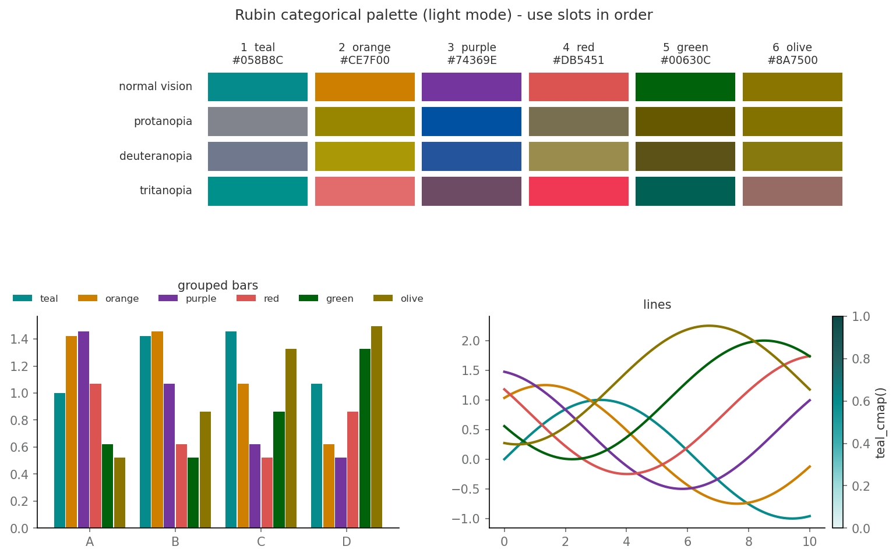
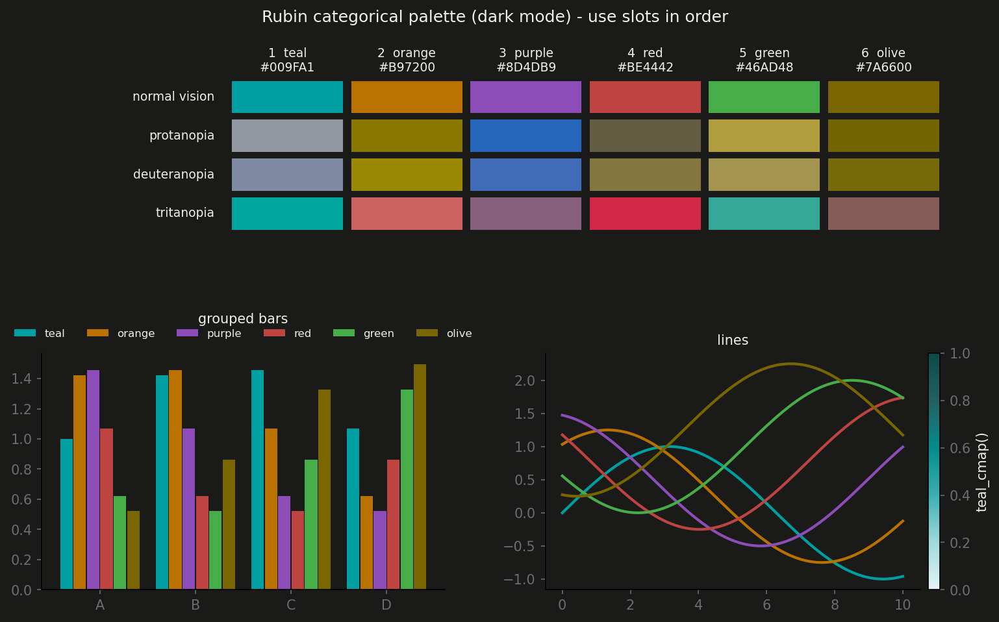

# Rubin colour palette for plots

A small, dependency-free (matplotlib only) colour palette for Rubin Observatory
plots and presentations. The primary colour is the Rubin brand teal
(`#058B8C`, Pantone 2237 C). The other five slots keep the hue of the accent
colours in the Rubin Visual Identity Manual (V7, 2021-02-12, pp. 27-30) but
have their lightness re-stepped so they are readable on a white slide and
stay distinguishable for colour-blind viewers.

## Categorical palette

Use the slots **in this order**. The order is what keeps adjacent colours
apart under protanopia / deuteranopia; do not re-order or skip slots.

| Slot | Name   | Light (white slides) | Dark (dark slides) | Origin                                   |
|------|--------|----------------------|--------------------|------------------------------------------|
| 1    | teal   | `#058B8C`            | `#009FA1`          | brand primary teal, exact / brand mid teal |
| 2    | orange | `#CE7F00`            | `#B97200`          | brand orange hue, darkened for contrast  |
| 3    | purple | `#74369E`            | `#8D4DB9`          | brand purple hue, lifted slightly        |
| 4    | red    | `#DB5451`            | `#BE4442`          | brand red hue                            |
| 5    | green  | `#00630C`            | `#46AD48`          | brand green hue                          |
| 6    | olive  | `#8A7500`            | `#7A6600`          | brand yellow hue, darkened to dark gold  |




The previews show each slot under simulated protanopia, deuteranopia and
tritanopia (Machado, Oliveira & Fernandes 2009, severity 1.0).

### Validation

Checked with a Python port of the `dataviz` palette validator (OKLab, Machado
CVD simulation, WCAG contrast):

| Check                                 | Light | Dark |
|---------------------------------------|-------|------|
| Lightness band (OKLCH L)              | pass  | pass |
| Chroma floor (C >= 0.10)              | teal is 0.098, kept exact on purpose | pass |
| Worst adjacent CVD dE (target >= 8)   | 9.3   | 10.0 |
| Worst adjacent normal-vision dE (>= 15) | 16.9 | 19.6 |
| Contrast vs surface (>= 3:1)          | all pass | all pass |

Caveats:

- Brand orange (`#FAB364`) and yellow (`#FFE266`) are far too pale for marks
  on white, so slots 2 and 6 are noticeably darker than the brand swatches.
- For scatter plots, where *any* two colours can touch, only the first three
  slots (teal, orange, purple) are mutually safe. Beyond that, fold series
  into "Other" or use small multiples.

## Other exports

- `BRAND` - the verbatim brand hex values (teals, steel, cool gray, accents).
- `NEUTRALS` - ink / secondary ink / muted / grid greys for text, axes and
  de-emphasised background bars.
- `SEQUENTIAL_TEAL` and `teal_cmap()` - a light-to-dark teal ramp for
  heatmaps and other magnitude encodings.
- `categorical_cmap(mode)` - the six slots as a `ListedColormap`.

## Usage

```python
import sys
sys.path.insert(0, "/sdf/home/b/bquint/notebooks/lsst-so/notebooks_bquint/rubin_color_pallete")
import rubin_palette as rp

rp.use()                          # set the matplotlib colour cycle (light mode)
rp.use(mode="dark")               # for dark slides

ax.plot(x, y, color=rp.TEAL)
ax.bar(x, y, color=rp.CATEGORICAL[1])            # orange
im = ax.imshow(z, cmap=rp.teal_cmap())
ax.bar(x, y_all, color=rp.NEUTRALS["muted"])     # background "all" bars

rp.preview("preview.png")                        # swatches + CVD simulation
```

Regenerate the preview images with:

```bash
python rubin_palette.py
```
